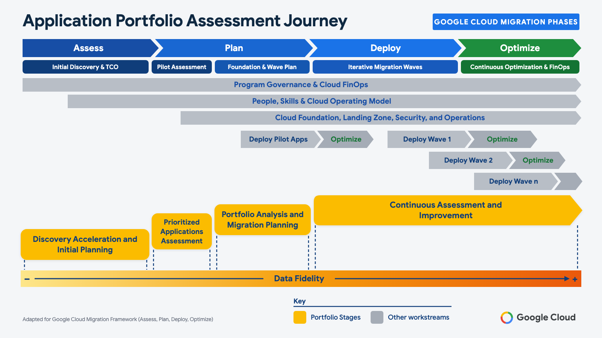
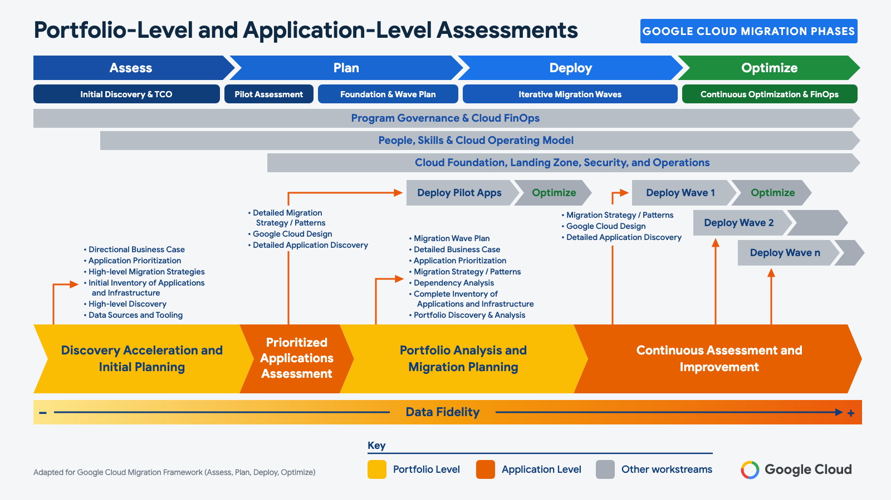

> **Guide:** Application portfolio assessment guide for Google Cloud migration  
> **Section:** 1. Introduction

[📚 Index](./README.md) | ➡️ Next: [Discovery acceleration and initial planning](./02-portfolio-discovery-initial-planning.md)

---

# Application portfolio assessment guide for Google Cloud migration

*Based on the AWS Prescriptive Guidance "Application portfolio assessment guide" by German Goncalves, Mark Berner, Tuhin Mukherjee, and Senay Swinney (Amazon Web Services); adapted for Google Cloud. See [Attribution](./README.md#attribution).*

This guide dives deep into implementing a structured [application portfolio assessment and migration strategy](https://cloud.google.com/architecture/migration-to-gcp-getting-started). You can use this guide to help you initiate and progress through the assessment of your portfolio of applications and associated infrastructure. The assessment includes discovery, analysis, and planning. Infrastructure includes compute, storage, and networks.

## Overview

Long-running cloud migration and modernization programs require the coordination of several cross-cutting workstreams—such as **Program Governance & Cloud FinOps**, **People, Skills & Cloud Operating Model**, **Cloud Foundation, Landing Zone, Security, and Operations** (an operative target environment with security controls), wave deployment, and application portfolio assessment. The names of these workstreams might vary depending on how you choose to organize your program. As a workstream, application portfolio assessment represents a foundational activity across the entire lifecycle of these programs. The understanding of the portfolio that is gained through the assessment provides a key input to other workstreams that depend on the data and analysis resulting from the continuous application portfolio assessment.

The following diagram shows how the stages of portfolio assessment correspond to the Google Cloud migration phases (**Assess**, **Plan**, **Deploy**, and **Optimize**) and other cross-cutting workstreams. The **Discovery acceleration and initial planning** stage takes place during the **Assess** phase, establishing the initial inventory, TCO, and rationalization baseline. **Prioritized applications assessment** bridges the transition from **Assess** into **Plan**, accelerating pilot workload design while informing cloud foundation requirements. The **Portfolio analysis and migration planning** stage occurs during the **Plan** phase alongside landing zone and wave planning. Finally, the **Continuous assessment and improvement** stage spans the **Deploy** and **Optimize** phases, supporting iterative wave execution, FinOps cost optimization, and ongoing application modernization throughout the migration lifecycle. The portfolio assessment stages are also valid outside of this framework, and they can be incorporated into any migration program structure.

- **Discovery acceleration and initial planning** focuses on the current understanding of the portfolio. It includes creating a directional business case, establishing base rationalization models for migration, and identifying initial migration candidates.
- **Prioritized applications assessment** delivers faster time-to-value through a detailed assessment, initial design of the target state architecture, and identification of applications that can be moved in the short term. Moving applications quickly provides teams with migration experience and establishes cloud foundations, such as an initial landing zone and other infrastructure components.
- **Portfolio analysis and migration planning** focuses on building a complete and up-to-date view of the application portfolio. The view is built by iteratively enriching the portfolio dataset, closing data gaps, evolving the business case, and creating high-confidence migration wave plans.
- **Continuous assessment and improvement** supports migrations at scale by producing detailed application and technology assessments for each migration wave as a continuous activity. This stage includes iterating the migration wave plan and conducting further analysis of migrated workloads for optimization and modernization.

The following diagram shows the key activities for each stage of assessment and how they pivot between portfolio-level assessment and application-level assessment. Portfolio-level assessment focuses on high-level discovery and overall analysis of the portfolio. For example, sources of portfolio data, application and infrastructure inventory, prioritization, high-level migration strategy, and directional business case. Application-level assessment focuses on the detailed discovery of one or more applications. For example, detailed application discovery, target Google Cloud design, and detailed migration strategy at the architecture and technology levels of the applications. Portfolio-level and application-level assessments represents the breadth and depth of information required.

## Attachments

To access additional content that is associated with this document, download and unzip the following file:

[attachment.zip](samples/attachment.zip)

- [6Rs-DecisionTree-GCP-baseModel.drawio](./samples/6Rs-DecisionTree-GCP-baseModel.drawio) (Extracted from `attachment.zip` — also view the [6 Rs Decision Tree Markdown & Mermaid Guide](./6rs-decision-tree.md))

---

[📚 Index](./README.md) | ➡️ Next: [Discovery acceleration and initial planning](./02-portfolio-discovery-initial-planning.md)
