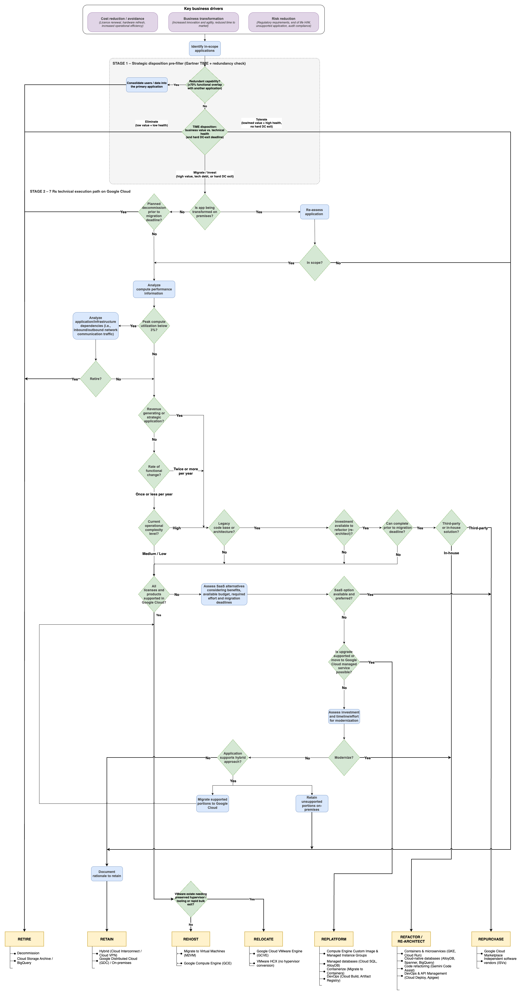

> **Guide:** Application portfolio assessment guide for Google Cloud migration  
> **Artifact:** 6 Rs (and 7 Rs) Decision Tree Base Model for Google Cloud (`6Rs-DecisionTree-GCP-baseModel.drawio`)  
> **Source:** [`samples/attachment.zip`](./samples/attachment.zip) in [Introduction](./01-introduction.md) and discussed in [Prioritization and migration strategy](./02.4-prioritization-and-migration-strategy.md)

[📚 Index](./README.md) | ⬆️ Related: [Prioritization and migration strategy](./02.4-prioritization-and-migration-strategy.md) | [Iterating the migration strategy selection](./04.4-iterating-migration-strategy-selection.md)

---

# 6 Rs (and 7 Rs) Migration & Modernization Decision Tree for Google Cloud (GCP)

This document captures the complete structure, terminology, decision logic, enterprise licensing rules, worked examples, and target **Google Cloud (GCP)** migration and modernization patterns from **`6Rs-DecisionTree-GCP-baseModel.drawio`**, enhanced with a **Stage 1 Strategic Disposition (Gartner TIME + Redundancy Check) pre-filter** for self-service application portfolio decisions.

- **Google Cloud Draw.io source file:** [`samples/6Rs-DecisionTree-GCP-baseModel.drawio`](./samples/6Rs-DecisionTree-GCP-baseModel.drawio)
- **Google Cloud decision tree diagram:** [`images/089b1c22-02d9-4e67-a9f5-413a2a60d13c.png`](./images/089b1c22-02d9-4e67-a9f5-413a2a60d13c.png) (rendered from the draw.io model)

The draw.io model, the diagram, and the Mermaid flowchart in [section 3](#3-unified-two-stage-decision-flowchart-stage-1-time--stage-2-7-rs-on-google-cloud) follow the same logic, including the Stage 1 pre-filter, the VMware question, and the separate **RELOCATE** outcome.

---

## 1. Terminology & Definitions (Google Cloud Adapted)

### General Terminology

| Term | Definition |
| --- | --- |
| **Application** | A program, database, module, service, package, etc., including supporting infrastructure. |
| **Migration / Modernization Strategy** | A high-level description of the approach to treat, move, or modernize the application or component (for example, *Rehost*, *Relocate*, *Replatform*, *Refactor*, *Repurchase*, *Retire*, *Retain*). Note: When **Relocate** (VMware) is tracked separately from **Rehost**, the 6 Rs are referred to as the **7 Rs**. |
| **Migration Center** | [Google Cloud Migration Center](https://cloud.google.com/migration-center) — unified discovery, TCO, right-sizing, and modernization fit (`mFit`) service. |
| **M2VM** | [Google Cloud Migrate to Virtual Machines](https://cloud.google.com/migrate/virtual-machines) — agentless replication and lift-and-shift to Google Compute Engine (GCE). |
| **GCVE** | [Google Cloud VMware Engine](https://cloud.google.com/vmware-engine) — fully managed VMware SDDC environment on Google Cloud bare-metal infrastructure. |
| **M2C** | [Migrate to Containers](https://cloud.google.com/migrate/containers) — automated containerization of VM workloads to GKE and Cloud Run. |
| **DMS / DMA** | [Database Migration Service](https://cloud.google.com/database-migration) and open-source [Database Migration Assessment](https://github.com/GoogleCloudPlatform/database-assessment). |
| **RaMP** | [Google Cloud Rapid Migration and Modernization Program](https://cloud.google.com/solutions/cloud-migration-program) — holistic migration framework, technical guidance, and funding/incentive program. |
| **EOL / EOSL** | End Of Life / End Of Service Life |
| **COTS / SaaS** | Commercial Off-The-Shelf product / Software as a Service product |

### The 6 Rs / 7 Rs Strategy Definitions & Target Google Cloud Services

The leaf targets below match the leaves in the Google Cloud decision tree diagram and draw.io model ([`images/089b1c22-02d9-4e67-a9f5-413a2a60d13c.png`](./images/089b1c22-02d9-4e67-a9f5-413a2a60d13c.png)):

| Strategy | Definition | Target Google Cloud Services & Approaches |
| --- | --- | --- |
| **Retire** | Decommission the application (or consolidate into an existing application) without migrating or modernizing. | - Decommission - **Cloud Storage Archive** / **BigQuery** (for historical compliance data retention) |
| **Retain** | Keep running the application in its current location (either permanently as *Tolerate*, temporarily, or in a hybrid topology). | - Hybrid (**Cloud Interconnect** / **Cloud VPN**) - **Google Distributed Cloud (GDC)** / On-premises |
| **Rehost** | Rapid lift-and-shift migration of servers and applications to Compute Engine without architectural, technology, or functionality changes. | - **Migrate to Virtual Machines (M2VM)** - **Google Compute Engine (GCE)** (predefined or custom machine types, with CUDs for steady-state usage or SUDs on eligible on-demand usage) |
| **Relocate** | Rapid movement of VMware workloads to Google Cloud without hypervisor, guest OS, or IP address changes. Tracking Relocate separately turns the 6 Rs into the **7 Rs**. | - **Google Cloud VMware Engine (GCVE)** - **VMware HCX** (no hypervisor conversion) |
| **Replatform** | Enhancement or upgrade of the application's underlying components (OS, runtime, containers, or managed databases) without rewriting core business logic. | - **Compute Engine Custom Image & Managed Instance Groups (MIGs)** - **Managed databases (Cloud SQL, AlloyDB)** - **Containerize (Migrate to Containers $\rightarrow$ GKE / Cloud Run)** - **DevOps (Cloud Build, Artifact Registry)** |
| **Refactor / Re-architect** | Modernization of the application by applying substantial changes to the codebase and/or architecture (e.g., microservices, serverless, cloud-native data/AI). | - **Containers & microservices (GKE, Cloud Run)** - **Cloud-native databases (AlloyDB, Spanner, BigQuery)** - **Code refactoring (Gemini Code Assist)** - **DevOps & API Management (Cloud Deploy, Apigee)** |
| **Repurchase** | Purchase, configure, or customize a COTS or SaaS product to replace an in-house or legacy third-party system. | - **Google Cloud Marketplace** - **Independent software vendors (ISVs)** |

---

## 2. Key Business Drivers

At the top of the decision tree, the organization defines and aligns on its **Key business drivers**:

1. **Cost reduction / avoidance** — *License renewal, hardware refresh, data-center exit, increased operational efficiency*
2. **Business transformation** — *Increased innovation and agility, reduced time to market, AI and data-driven capabilities*
3. **Risk reduction** — *Regulatory requirements, end-of-life (EOL) hardware/OS/DB, unsupported application, audit compliance*

---

## 3. Unified Two-Stage Decision Flowchart (Stage 1: TIME + Stage 2: 7 Rs on Google Cloud)

When used in a **self-service application decision tool** (where migrating to the cloud is *not* assumed to be the default for every app), **Stage 1 (Gartner TIME + Redundancy Check)** runs first to determine *whether* the application should be migrated/modernized, kept in place, or eliminated, and **Stage 2** determines the exact **6 Rs / 7 Rs** strategy and Google Cloud target services:

```mermaid
flowchart TD
    subgraph Stage1["STAGE 1: Strategic Disposition Pre-Filter (Gartner TIME + Redundancy)"]
        Drivers["Key Business Drivers:<br/>1. Cost reduction / avoidance<br/>2. Business transformation<br/>3. Risk reduction"] --> Identify["Identify in-scope applications"]
        Identify --> Q_Overlap{"Redundant capability?<br/>(>70% overlap with another<br/>target application)"}
        Q_Overlap -- "Yes" --> Consolidate["Consolidate users/data into<br/>primary application"]
        Q_Overlap -- "No" --> Q_TIME{"Evaluate TIME Matrix:<br/>Business Value vs. Technical Health<br/>(& Hard DC Exit Deadline)"}
        Q_TIME -- "Eliminate:<br/>Low Business Value +<br/>Low Tech Health" --> RETIRE
        Q_TIME -- "Tolerate:<br/>Low/Med Business Value +<br/>High Tech Health + No DC Exit" --> DocRetain["Document rationale to retain<br/>& optimize in place"]
    end

    subgraph Stage2["STAGE 2: Technical Execution Path (6 Rs / 7 Rs Decision Tree on Google Cloud)"]
        Q_TIME -- "Migrate or Invest:<br/>High Business Value, High Tech Debt,<br/>or Hard DC Exit Deadline" --> Q_OnPrem{"Is app being transformed<br/>on premises?"}

        Q_OnPrem -- "Yes" --> Reassess["Re-assess application"]
        Reassess --> Q_InScope{"In scope?"}
        Q_InScope -- "No" --> DocRetain
        Q_InScope -- "Yes" --> AnalyzePerf["Analyze compute performance information"]

        Q_OnPrem -- "No" --> Q_Decomm{"Planned decommission prior<br/>to migration deadline?"}
        Q_Decomm -- "Yes" --> RETIRE
        Q_Decomm -- "No" --> AnalyzePerf

        AnalyzePerf --> Q_PeakCPU{"Peak compute utilization<br/>below 3%?"}
        Q_PeakCPU -- "Yes" --> AnalyzeDeps["Analyze application/infrastructure dependencies<br/>(inbound/outbound network traffic)"]
        AnalyzeDeps --> Q_Retire{"Retire?"}
        Q_Retire -- "Yes" --> RETIRE
        Q_Retire -- "No" --> Q_Strategic{"Revenue generating or<br/>strategic application?"}
        Q_PeakCPU -- "No" --> Q_Strategic

        Q_Strategic -- "Yes" --> Q_Legacy{"Legacy code base<br/>or architecture?"}
        Q_Strategic -- "No" --> Q_ChangeRate{"Rate of functional<br/>change?"}

        Q_ChangeRate -- "Twice or more per year" --> Q_Legacy
        Q_ChangeRate -- "Once or less per year" --> Q_Complexity{"Current operational<br/>complexity level?"}

        Q_Complexity -- "High" --> Q_Legacy
        Q_Complexity -- "Medium / Low" --> Q_Licenses{"All licenses and products<br/>supported in Google Cloud?"}

        Q_Legacy -- "No" --> Q_Licenses
        Q_Legacy -- "Yes" --> Q_Invest{"Investment available to<br/>refactor (re-architect)?"}
        Q_Invest -- "No" --> Q_Licenses
        Q_Invest -- "Yes" --> Q_Deadline{"Can complete prior to<br/>migration deadline?"}
        Q_Deadline -- "No" --> Q_Licenses
        Q_Deadline -- "Yes" --> Q_SolutionType{"Third-party or<br/>in-house solution?"}

        Q_SolutionType -- "In-house" --> REFACTOR["REFACTOR / RE-ARCHITECT<br/>• Containers & microservices (GKE, Cloud Run)<br/>• Cloud-native DBs (AlloyDB, Spanner, BigQuery)<br/>• Code refactoring (Gemini Code Assist)<br/>• DevOps & API Mgmt (Cloud Deploy, Apigee)"]
        Q_SolutionType -- "Third-party" --> REPURCHASE["REPURCHASE<br/>• Google Cloud Marketplace<br/>• Independent software vendors (ISVs)"]

        Q_Licenses -- "Yes" --> Q_VMware{"VMware estate requiring<br/>preserved hypervisor/tooling<br/>or rapid bulk exit?"}
        Q_VMware -- "Yes (Relocate)" --> RELOCATE["RELOCATE<br/>• Google Cloud VMware Engine (GCVE)<br/>  via VMware HCX"]
        Q_VMware -- "No (Rehost)" --> REHOST["REHOST<br/>• Migrate to Virtual Machines (M2VM)<br/>• Google Compute Engine (GCE)"]

        Q_Licenses -- "No" --> AssessSaaS["Assess SaaS alternatives considering benefits,<br/>available budget, required effort & deadlines"]
        AssessSaaS --> Q_SaaS{"SaaS option available<br/>and preferred?"}

        Q_SaaS -- "Yes" --> REPURCHASE
        Q_SaaS -- "No" --> Q_Upgrade{"Is upgrade supported or move to<br/>Google Cloud managed service possible?"}

        Q_Upgrade -- "Yes" --> REPLATFORM["REPLATFORM<br/>• GCE Custom Image & MIGs<br/>• Managed DBs (Cloud SQL, AlloyDB)<br/>• Containerize (Migrate to Containers)<br/>• DevOps (Cloud Build, Artifact Registry)"]
        Q_Upgrade -- "No" --> AssessMod["Assess investment and timeline/effort<br/>for modernization"]
        AssessMod --> Q_Modernize{"Modernize?"}

        Q_Modernize -- "Yes" --> REFACTOR
        Q_Modernize -- "No" --> Q_Hybrid{"Application supports<br/>hybrid approach?"}

        Q_Hybrid -- "No" --> DocRetain
        Q_Hybrid -- "Yes" --> HybridMig["Migrate supported portions to Google Cloud"]
        Q_Hybrid -- "Yes" --> HybridRet["Retain unsupported portions on-premises"]

        HybridMig --> Q_VMware
        HybridRet --> DocRetain
    end

    Consolidate --> RETIRE["RETIRE<br/>• Decommission<br/>• Cloud Storage Archive / BigQuery"]
    DocRetain --> RETAIN["RETAIN<br/>• Hybrid (Cloud Interconnect / Cloud VPN)<br/>• Google Distributed Cloud (GDC) / On-premises"]
```

---

## 4. Google Cloud Workload & Licensing Decision Rules

Two of the most important decision points in the tree are **"All licenses and products supported in Google Cloud?"** and **"Is upgrade supported or move to Google Cloud managed service possible?"**, along with choosing between **Rehost** and **Relocate**. Use the table below to evaluate specialized enterprise workloads on Google Cloud:

| Workload / License Category | Decision Criteria | Recommended R Strategy & Google Cloud Path |
| --- | --- | --- |
| **1. VMware Estate** *(Rehost vs. Relocate)* | • **Need fastest exit (<3–6 mos)**, hundreds of VMs, reliance on vCenter/NSX/vSAN operations, or unmodifiable guest OS/drivers • **Want to exit VMware licensing**, right-size VMs, and adopt native cloud operations | • **Relocate $\rightarrow$ [Google Cloud VMware Engine (GCVE)](https://cloud.google.com/vmware-engine)** using VMware HCX (zero guest OS or hypervisor change) • **Rehost $\rightarrow$ [Google Compute Engine (GCE)](https://cloud.google.com/compute)** via **[Migrate to Virtual Machines (M2VM)](https://cloud.google.com/migrate/virtual-machines)** with Custom Machine Types and CUDs |
| **2. Oracle Databases** *(Licensing & Architecture)* | • **Keep Oracle engine + use OCI Exadata/Autonomous DB** with OCI license mobility / ULA / BYOL • **Keep Oracle engine + strict physical socket/core BYOL** compliance outside OCI • **Exit commercial Oracle licenses** and modernize to open-source compatible managed DB | • **Rehost / Replatform $\rightarrow$ [Oracle Database@Google Cloud](https://cloud.google.com/oracle/database/docs/overview)** (OCI Exadata hardware running inside Google Cloud data centers) • **Rehost $\rightarrow$ [Bare Metal Solution (BMS) for Oracle](https://cloud.google.com/bare-metal)** (certified non-virtualized physical servers connected via low-latency Cloud Interconnect) • **Replatform / Refactor $\rightarrow$ [AlloyDB for PostgreSQL](https://cloud.google.com/alloydb)** or **Cloud SQL** using **[Database Migration Assessment (DMA)](https://github.com/GoogleCloudPlatform/database-assessment)** and **DMS Conversion Workspaces (with Gemini)** |
| **3. Microsoft Windows Server & SQL Server** | • **No transferable BYOL license** or prefer consumption-based licensing • **SQL Server / SharePoint / Exchange with active Software Assurance (SA)** (License Mobility applies to server applications only) • **Windows Server BYOL** (not covered by License Mobility) that meets Microsoft's October 1, 2019 eligibility rules • **Eliminate Windows/SQL Server licensing toil** | • **Rehost / Replatform (PAYG) $\rightarrow$** License-included **Compute Engine** images or **Cloud SQL for SQL Server** • **Rehost (BYOL multi-tenant) $\rightarrow$** Multi-tenant **Compute Engine** using Microsoft License Mobility • **Rehost (BYOL dedicated) $\rightarrow$** **[Compute Engine sole-tenant nodes](https://cloud.google.com/compute/docs/nodes/sole-tenant-nodes)** (supports physical core pinning and vCPU overcommit to minimize core license consumption). **Eligibility caveat:** generally only product versions released before October 1, 2019 (for example, Windows Server 2019 or earlier, not 2022 or later) and licenses acquired under an enrollment effective before that date (or trued-up under such an Enterprise Agreement) qualify — see the [Compute Engine Microsoft licensing FAQ](https://cloud.google.com/compute/docs/instances/windows/ms-licensing-faq); otherwise use license-included images • **Refactor / Replatform $\rightarrow$** Modernize .NET Framework to modern .NET on **Linux (GKE / Cloud Run)** and SQL Server to **AlloyDB for PostgreSQL** |
| **4. SAP Workloads** *(SAP HANA / NetWeaver / S/4HANA)* | • **SAP HANA database** within certified VM memory sizes (the `X4` series scales up to 32 TB) • **SAP NetWeaver / S/4HANA application servers** • **Bare-metal requirement** or footprint outside certified VM configurations | • **Rehost / Replatform $\rightarrow$** SAP HANA on SAP-certified memory-optimized **Compute Engine** series (such as `M2`, `M3`, `X4`) with the Google Cloud Agent for SAP • **Rehost / Replatform $\rightarrow$** application servers on certified general-purpose series (such as `C3`, `N2`) • **Rehost $\rightarrow$ [Bare Metal Solution for SAP](https://cloud.google.com/bare-metal)** • Confirm machine types against the [SAP HANA certifications list](https://cloud.google.com/sap/docs/certifications-sap-hana) |
| **5. Mainframe & Legacy RISC/Unix** *(IBM z/OS, AS/400, AIX, Solaris, HP-UX)* | • **Mainframe (COBOL / PL/I / JCL / DB2 / VSAM):** Strategic modernization vs. rapid emulator lift • **Legacy RISC/Unix (AIX, Solaris, HP-UX):** Cannot run Power/SPARC binaries natively on x86/Arm GCE | • **Mainframe Refactor / Replatform $\rightarrow$ [Google Cloud Mainframe Modernization](https://cloud.google.com/mainframe-modernization)** (assess with Mainframe Assessment Tool, validate with **Dual Run** parallel testing, and either automated-refactor COBOL to Java on **GKE / Cloud Run + AlloyDB / Cloud SQL** or replatform with emulation on **GCE**) • **RISC/Unix $\rightarrow$** **Replatform** (port/recompile app onto Linux on GCE/GKE + migrate DB via DMS), **Repurchase (SaaS)**, or **Retain / Hybrid** |

---

## 5. Worked End-to-End Decision Examples

### Example 1: Three-Tier Customer Portal on VMware (Java / Tomcat + PostgreSQL)
- **Workload Profile:** Customer-facing order portal running on 6 VMware VMs (2 Apache web servers, 2 Java/Tomcat app servers, 2 self-managed PostgreSQL 12 DB VMs). Peak CPU utilization is 48%. Releases occur 6 times per year.
- **Stage 1 (TIME Pre-Filter):**
  - *Redundancy:* None (primary customer portal).
  - *Business Value:* High (revenue-generating). *Technical Health:* Medium-Low (manual VM patching and self-managed DB failover toil).
  - *Stage 1 Output:* **Migrate / Invest** $\rightarrow$ Proceed to Stage 2 per component tier.
- **Stage 2 (Component-by-Component Tree Traversal):**
  - **Web & App Tiers (Apache + Java/Tomcat):** Strategic (`Yes`) $\rightarrow$ Legacy code base or architecture? (`Yes`, VM-bound monolith) $\rightarrow$ Investment available to refactor (re-architect)? (`No`, no budget for a microservices rewrite) $\rightarrow$ All licenses and products supported in Google Cloud? (`Yes`, open-source Java on Linux) $\rightarrow$ VMware estate needing preserved hypervisor/tooling or rapid bulk exit? (`No`, only 6 VMs and the team wants native Google Cloud operations) $\rightarrow$ **Tree outcome: REHOST to Compute Engine via M2VM.**
    - **Documented override $\rightarrow$ REPLATFORM:** The pilot assessment showed the Tomcat tiers are stateless and that [Migrate to Containers (M2C)](https://cloud.google.com/migrate/containers) can containerize them with low effort, which removes the manual VM patching toil identified in Stage 1. Following the guidance in [02.4](./02.4-prioritization-and-migration-strategy.md) (override the outcome and record the rationale instead of changing the tree logic), the team records an exception and selects **REPLATFORM to GKE Autopilot (or Cloud Run)** behind **Cloud Load Balancing** and **Cloud Armor**. If containerization had proved costly, the tree outcome (Rehost) would stand.
  - **Database Tier (PostgreSQL 12):** Strategic (`Yes`) $\rightarrow$ Legacy code base or architecture? (`No`) $\rightarrow$ All licenses and products supported in Google Cloud? (`No`: PostgreSQL 12 reached community end of life in November 2024, so the current version is not supportable as-is) $\rightarrow$ SaaS option available and preferred? (`No`) $\rightarrow$ Is upgrade supported or move to Google Cloud managed service possible? (`Yes`) $\rightarrow$ **REPLATFORM to Cloud SQL for PostgreSQL (or AlloyDB)** on a supported major version, using **Database Migration Service (DMS)** for continuous replication and a short cutover window.

### Example 2: Mission-Critical Oracle E-Business Suite / ERP with Processor-Based BYOL Licenses
- **Workload Profile:** Core finance ERP running on-premises with a 12 TB Oracle 19c RAC database licensed via perpetual processor-based licenses (no Unlimited License Agreement) and a hard data-center lease expiration in 9 months.
- **Stage 1 (TIME Pre-Filter):**
  - *Business Value:* High. *Technical Health:* Low (aging hardware, hard lease exit).
  - *Stage 1 Output:* **Migrate** $\rightarrow$ Proceed to Stage 2.
- **Stage 2 (Component-by-Component Tree Traversal):**
  - **Application Tier (Linux x86):** Strategic (`Yes`) $\rightarrow$ Legacy code base or architecture? (`Yes`) $\rightarrow$ Investment available to refactor? (`No`) $\rightarrow$ All licenses and products supported in Google Cloud? (`Yes`) $\rightarrow$ VMware estate needing preserved hypervisor/tooling or rapid bulk exit? (`No`, physical servers) $\rightarrow$ **REHOST to Google Compute Engine (GCE)** using **Migrate to Virtual Machines (M2VM)** with 3-year Committed Use Discounts (CUDs).
  - **Database Tier (Oracle 19c RAC with strict BYOL):** Legacy (`Yes`) $\rightarrow$ Investment available to refactor? (`Yes`, for a PostgreSQL conversion) $\rightarrow$ Can complete prior to migration deadline? (`No`, not within 9 months) $\rightarrow$ All licenses and products supported in Google Cloud? (`No` on standard multi-tenant Compute Engine: RAC and the existing processor-based BYOL terms are not a fit) $\rightarrow$ SaaS option available and preferred? (`No`) $\rightarrow$ Is upgrade supported or move to Google Cloud managed service possible? (`Yes`, Oracle Database@Google Cloud) $\rightarrow$ **REPLATFORM**:
    - **Phase 1 (Meet 9-month DC exit):** **REPLATFORM to [Oracle Database@Google Cloud](https://cloud.google.com/oracle/database/docs/overview)** (or, as a documented alternative, **REHOST to [Bare Metal Solution for Oracle](https://cloud.google.com/bare-metal)** if the team must keep managing the full Oracle stack itself) inside the same Google Cloud region as the GCE app tier, preserving existing Oracle licensing compliance and RAC high availability.
    - **Phase 2 (Post-migration optimization):** Run **[Database Migration Assessment (DMA)](https://github.com/GoogleCloudPlatform/database-assessment)** to evaluate future replatforming of non-ERP reporting schemas to **AlloyDB for PostgreSQL** or **BigQuery**.

### Example 3: Two Low-Utilization Internal Departmental Apps (Legacy HR Reporting & Compliance Archive)
- **Workload Profile:**
  - *App A (Legacy HR Crystal Reports Server):* Windows Server 2012 R2 VM, peak CPU utilization `1.4%`, zero inbound network connections over the last 60 days; capability was superseded by Workday 18 months ago.
  - *App B (On-Premises Manufacturing Lab Calibration Tool):* Vendor appliance VM tied to local serial/PLC lab equipment on the factory floor, `8%` CPU utilization, stable, vendor does not support public cloud deployment, no factory closure planned.
- **Decision Path:**
  - **App A:** Stage 1: Redundant capability? (`Yes`, superseded by Workday) $\rightarrow$ Consolidate into the primary application $\rightarrow$ **RETIRE**. The Stage 2 idle check corroborates this: peak compute utilization `<3%` (`Yes`) and no active consumers in the dependency analysis. Retirement actions: export final historical snapshots to **Cloud Storage Archive** for 7-year audit retention and decommission the VM.
  - **App B:** Stage 1: Redundant capability? (`No`) $\rightarrow$ TIME disposition = **Tolerate** (low business differentiation, stable, no factory closure or DC-exit deadline) $\rightarrow$ **Document rationale to retain** $\rightarrow$ **RETAIN** on-premises (keep running on local factory floor infrastructure and re-evaluate in 24 months).

---

[📚 Index](./README.md) | ⬆️ Related: [Prioritization and migration strategy](./02.4-prioritization-and-migration-strategy.md) | [Iterating the migration strategy selection](./04.4-iterating-migration-strategy-selection.md)
